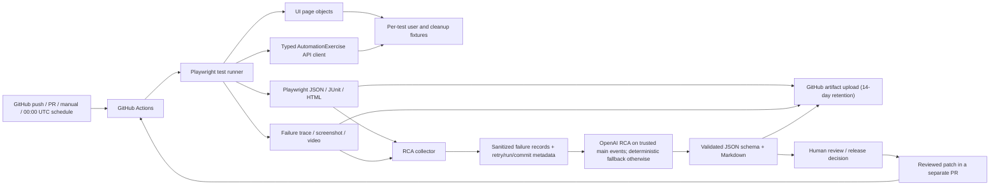

# Automation and RCA Architecture

## Interfaces and boundaries

- **Decision policy:** See the [AI Decision Matrix](./ai-decision-matrix.md) for executable fallback rules, role handoffs, confidence gates, and authority limits.
- **Inputs:** scenario IDs and risk tags, Playwright JSON results, stack traces, retry attempts, and artifact paths.
- **Test interfaces:** page objects use the browser `Page`; `AutomationExerciseApi` uses a request context rooted at `API_URL`; fixtures provide unique accounts and attempt account deletion during teardown.
- **RCA interface:** the collector writes `failures.json` plus collection status; the analyzer validates each record against the exported Zod schema and writes `rca-report.json` and `rca-summary.md`.
- **Outputs:** Playwright JSON/JUnit/HTML reports, failure media, structured RCA, and versioned sanitized provider prompt/output evidence are uploaded as one workflow artifact.
- **AI boundary:** Current assessment evidence uses the model-free deterministic fallback. The optional analyzer may send bounded, redacted failure text to OpenAI only on trusted `main` events when `OPENAI_API_KEY` is configured; PR and non-main workflows do not receive the secret. Provider classifications remain pending human approval.
- **Autonomy boundary:** Work is decomposed into test execution, evidence collection, deterministic RCA, quality gating, remediation proposal, and human approval. These are tool-mediated roles, not an autonomous multi-agent runtime. The system cannot change code, merge, or deploy on its own.
- **Stop conditions:** missing evidence yields `UNKNOWN` or a pending hypothesis; low confidence and controlled fault injections require human review. No agent may merge or deploy a patch.

The skills and orchestrator documents describe the proposed human-supervised workflow; they are contracts, not an autonomous agent runtime.
